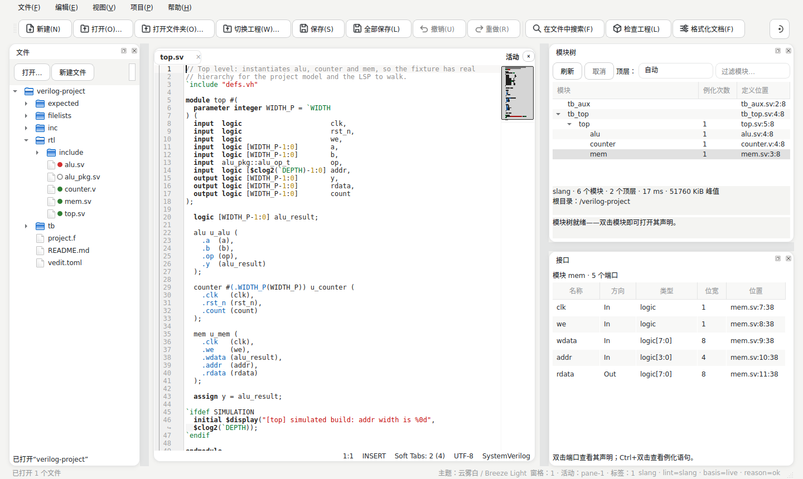

# VEdit

VEdit 是面向 Verilog 和 SystemVerilog 工程的 Linux 桌面编辑器。导入仿真或综合用的 `.f` 文件清单，就可以沿模块实例阅读 RTL，从信号跳到驱动端或负载端，也可以在编辑器里比较工作文件与 SVN 历史修订。

[下载 Linux AppImage](https://github.com/HaroldZ32/VEdit/releases/latest) · [用户手册](docs/USER_GUIDE.md) · [报告问题](https://github.com/HaroldZ32/VEdit/issues)



## 安装与运行

从 [Releases](https://github.com/HaroldZ32/VEdit/releases) 下载 x86_64 AppImage 和同一版本的 `SHA256SUMS`，放在同一目录。以下命令适用于 0.4.0。

```sh
sha256sum -c SHA256SUMS
chmod +x VEdit-0.4.0-x86_64.AppImage
./VEdit-0.4.0-x86_64.AppImage
```

AppImage 随附 Qt、HDL 分析工具、Git 和 Subversion，普通用户即可运行。已在 CentOS 7.9 和 Rocky Linux 9.3 的 x86_64 用户态环境验证启动。机器没有 FUSE 时，可用 `./VEdit-0.4.0-x86_64.AppImage --appimage-extract-and-run` 启动。

## 打开第一个工程

1. 用 **File → Open Folder…** 选择 RTL 工程根目录。如果只想编辑一个源文件，直接按 `Ctrl+O` 打开即可。
2. 在 **Project** 面板点击 **Import Filelist…**，选择工程的 `.f`。VEdit 会解析嵌套的 `-f`、`+incdir+` 和 `+define+`，并在后台生成模块树。
3. 在 **Module Tree** 中双击模块打开定义，或在 **Interface** 面板查看端口方向、类型和位宽。将光标放在已保存源码的信号名上，右键选择 **Trace Driver** 或 **Trace Load** 查看直接连接。要展开跨实例的分支，选择 **Show Driver Chain** 或 **Show Load Chain**。

想试试信号追踪，可以打开仓库中的示例目录，导入 `sources.f`，再从 `top.sv` 的 `merged` 信号查看驱动链。[打开示例](tests/fixtures/signal_trace)

## 编辑、诊断与版本控制

- **代码导航**　`F12` 跳到定义，`Shift+F12` 查找引用，`Ctrl+P` 按文件名定位。分屏、多光标、代码折叠和工程搜索适合对照阅读多个模块。
- **HDL 诊断**　Verilog/SystemVerilog 默认使用 slang-server 提供语义导航，也可选择 Verible。编辑时在 **Outline** 查看当前文件的诊断，需要检查完整工程时运行 **Project → Lint Project**。
- **双栏比较**　从 **File → Compare Files…** 或文件树右键菜单选择两个文件。差异块按行对齐，中间箭头可向任一可写侧应用当前块，支持撤销和单侧保存。
- **Git 与 SVN**　在 **Source Control** 中查看变更、提交和历史。SVN 支持变更列表、分支、合并和多个工作副本；`BASE`、`HEAD`、指定修订和工作文件可以在同一个比较窗口中打开。

## 构建与贡献

在装有 Git 和 Docker 的 Linux 主机上，克隆仓库后运行构建脚本。

```sh
git clone https://github.com/HaroldZ32/VEdit.git
cd VEdit
bash scripts/fetch-verible.sh
bash build/slang/build.sh
bash scripts/build-qt.sh
  ```

VEdit 使用 Qt 6、KDE Frameworks、KTextEditor 和 Rust。构建脚本编译并运行测试，生成 `target/qt6-build/src/app/vedit-app`。工具链、AppImage 打包和各项测试的独立入口见[构建指南](docs/BUILD.md)。

欢迎提交 Issue 或 Pull Request。报告 HDL 分析问题时，请附上可公开的最小源码、相关 `.f` 和预期结果。代码和文档改动从 `dev` 创建分支，并向 `dev` 提交 PR。[贡献与发布流程](docs/RELEASING.md)

## 许可证

VEdit 使用 [MIT 许可证](LICENSE)。随包第三方组件的许可证和源码来源见[第三方声明](THIRD_PARTY_NOTICES.md)。
