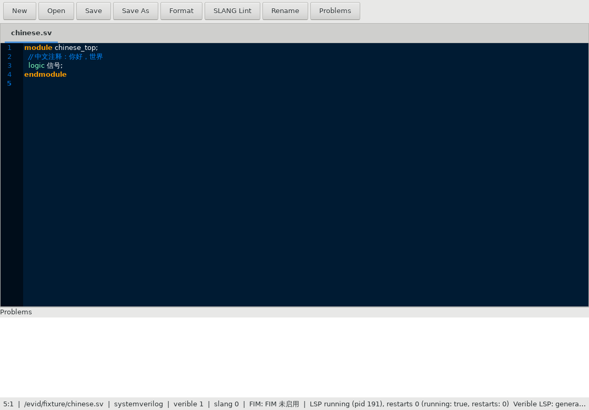

# VEdit — 面向 Verilog / SystemVerilog 的桌面编辑器

VEdit 是一个用 **Rust + GTK3 + GtkSourceView** 写的 Verilog / SystemVerilog 专用文本编辑器，
目标环境是 **CentOS 7.9 x86_64（glibc 2.17）**：**免安装、无 root、可完全离线**运行。
IDE 能力全部复用上游组件（Verible、SLANG、GtkSourceView），自研只限胶水层。



## 五项能力

| # | 能力 | 实现来源 |
|---|---|---|
| 1 | **语法高亮**：`.v/.vh` → Verilog，`.sv/.svh/.svi` → SystemVerilog | 上游 GtkSourceView 4.6.1 的 `verilog.lang` / `systemverilog.lang` + `cobalt` 主题，**不写词法器** |
| 2 | **在线 lint / 一键格式化 / 跳转 / 引用 / 符号大纲 / 重命名预览** | 单一 LSP 客户端接入 `verible-verilog-ls` |
| 3 | **SLANG 深度 lint**（默认 `Ctrl+Shift+L`） | `slang --lint-only -Weverything --diag-json`，结果进问题面板与行号栏 |
| 4 | **可选 FIM 补全**（行内 ghost text） | 可插拔后端：OpenAI 兼容 `/v1/completions` 或 llama.cpp `/infill`；**默认关闭、零网络** |
| 5 | 中文注释 / 中文查找词 | 捆绑 WenQuanYi Zen Hei 字体 + `gtk3-immodule-xim` / `ibus-gtk3` 输入法模块 |

## 三种产物，怎么选

| 产物 | 大小（0.1.0） | 适用场景 |
|---|---|---|
| `VEdit-<ver>-x86_64.AppImage` | ≈ 48 MB | 最省事。`chmod +x` 后直接运行；**需要 FUSE**。没有 FUSE 时用 `--appimage-extract-and-run`（或 `APPIMAGE_EXTRACT_AND_RUN=1`） |
| `vedit-<ver>-linux-x86_64.tar.gz` | ≈ 41 MB | **不需要 FUSE**。解压后跑 `VEdit/vedit.sh`；适合内网、无 FUSE、无 `/tmp` 可执行位的老机器 |
| `VEdit-<ver>-x86_64.run` | ≈ 41 MB | **单文件自解压**，不依赖 FUSE。`sh VEdit-<ver>-x86_64.run` 或 `chmod +x && ./VEdit-*.run`；自动挑选可执行的临时目录，失败时明确报错并给出替代方案 |

> **FUSE 缺失时优先用 `.run` 或 tar.gz**：CentOS 7 通常没有 `fusermount3`，AppImage 直接运行可能以
> `No suitable fusermount binary found` 退出 127。

三者都自带：GTK3 运行时、GtkSourceView 4.6.1 数据（163 个语言定义 + 主题）、
`verible-verilog-ls/-lint/-format`、`slang`、gdk-pixbuf loaders、GSettings schemas、
DejaVu + 文泉驿字体。**包内所有 ELF 的最高 GLIBC 符号版本 ≤ 2.17**。

## 快速开始

```sh
# 1) AppImage（有 FUSE 时）
chmod +x VEdit-0.1.0-x86_64.AppImage
./VEdit-0.1.0-x86_64.AppImage                      # 或：./VEdit-0.1.0-x86_64.AppImage --appimage-extract-and-run

# 2) 单文件自解压（推荐给 CentOS 7）
sh VEdit-0.1.0-x86_64.run                          # 打开一个空编辑器
sh VEdit-0.1.0-x86_64.run path/to/top.sv           # 直接打开文件

# 3) 目录包
tar xzf vedit-0.1.0-linux-x86_64.tar.gz
./VEdit/vedit.sh path/to/top.sv
```

打开文件后：`Ctrl+Shift+F` 格式化，`Ctrl+Shift+L` 跑 SLANG 深度 lint，`F12` 跳转定义，
`Ctrl+Shift+P` 开关问题面板。完整快捷键见下文。

运行自检（不需要任何额外环境，也不需要网络）：

```sh
sh VEdit-0.1.0-x86_64.run --selftest all      # 6 个套件 / 51 项检查；成功 exit 0
```

## 配置

配置按以下优先级叠加（后者覆盖前者）：

1. 内置默认值；
2. 用户配置 `$XDG_CONFIG_HOME/vedit/vedit.toml`（默认 `~/.config/vedit/vedit.toml`）；
3. 工程配置 `<工程根>/vedit.toml`（从打开文件所在目录向上查找，最近的 `vedit.toml` 或 `.git` 即工程根）；
4. 环境变量 `VEDIT_FIM_*`（仅 FIM 设置）。

```toml
[ui]
language = "zh-CN"          # 界面语言
theme = "cobalt"            # GtkSourceView 主题（上游 scheme 名）

[editor]
tab_width = 4
insert_spaces = true
show_line_numbers = true
highlight_current_line = false

# 快捷键：按“动作名”重绑，动作名见下方快捷键表的“动作”列
# （接受 "Ctrl+Shift+F" 这种人类写法，也接受 "<Ctrl><Shift>f" 这种 GTK 写法）
[keys]
format = "Ctrl+Shift+F"
slang = "Ctrl+Shift+L"
definition = "F12"
references = "Shift+F12"
outline = "Ctrl+Shift+O"
fim = "Alt+\\"
accept-fim = "Tab"
cancel-fim = "Esc"

# 工程发现：额外的 filelist / include 目录 / 宏定义
[project]
filelists = ["rtl/files.f"]
include_dirs = ["rtl/include"]
defines = ["SYNTHESIS", "WIDTH=32"]

# 工具路径覆盖（不填则按“配置 → 环境变量 → 包内路径”解析，绝不查 PATH）
[verible]
# ls = "/opt/verible/bin/verible-verilog-ls"
# format = "..."
# lint = "..."

# 可选 FIM：默认关闭，无默认端点、无默认模型、无默认密钥
[fim]
enabled = false
protocol = "open_ai"        # 或 "llama_cpp"
endpoint = ""               # 例：http://127.0.0.1:8080
model = ""                  # OpenAI 兼容协议需要；llama.cpp 不需要
timeout_ms = 5000
# api_key 只从配置或环境变量读取，绝不写进日志/错误/状态栏
```

工程发现还会自动读取：工程根及以上的 `.rules.verible_lint`（Verible lint 规则）、
`*.f` filelist、以及 `[project]` 里的 include/define。

> 提示：配置里引用的路径（`filelists` / `include_dirs` / 工具路径）不存在时，启动会打印
> **configuration warnings**（数量写在启动日志里），但不会阻止启动——按提示修正即可。

环境变量：`VEDIT_FIM_ENDPOINT`、`VEDIT_FIM_MODEL`、`VEDIT_FIM_API_KEY`、`VEDIT_FIM_PROTOCOL`、
`VEDIT_FIM_TIMEOUT_MS`、`VEDIT_FIM_ENABLED`；工具覆盖 `VEDIT_VERIBLE_LS|FORMAT|LINT`、
`VEDIT_VERIBLE_DIR`、`VEDIT_SLANG`；GtkSourceView 数据目录 `VEDIT_GSV_DATADIR`（一般无需设置，
包内启动脚本已设好）。

## 快捷键

| 动作（`[keys]` 键名） | 默认键 | 说明 |
|---|---|---|
| `open` | `Ctrl+O` | 打开文件（新标签） |
| `new` | `Ctrl+N` | 新建未命名标签 |
| `save` / `save-as` | `Ctrl+S` / `Ctrl+Shift+S` | 保存 / 另存为 |
| `close-tab` / `quit` | `Ctrl+W` / `Ctrl+Q` | 关闭标签（未保存会确认）/ 退出 |
| `undo` / `redo` | `Ctrl+Z` / `Ctrl+Shift+Z` | 撤销 / 重做（GtkSourceView 原生撤销栈） |
| `find` / `replace` / `find-next` | `Ctrl+F` / `Ctrl+H` / `F3` | 查找 / 替换 / 下一个匹配 |
| `goto-line` | `Ctrl+G` | 跳到行 |
| `format` | `Ctrl+Shift+F` | 一键格式化（Verible LSP，单步撤销） |
| `slang` | `Ctrl+Shift+L` | SLANG 深度 lint |
| `definition` | `F12` | 跳转定义 |
| `references` | `Shift+F12` | 查找引用 |
| `outline` | `Ctrl+Shift+O` | 符号大纲 |
| `rename` | `F2` | 重命名预览（只展示 LSP 给的编辑，不写入） |
| `fim` | `Alt+\` | 请求 FIM 补全（ghost text） |
| `accept-fim` / `cancel-fim` | `Tab` / `Esc` | 接受 / 取消待定补全 |
| `toggle-panel` | `Ctrl+Shift+P` | 显示/隐藏问题面板 |

重绑：把 `[keys]` 里对应“动作”列的名字改成想要的键，例如 `slang = "Ctrl+Alt+L"` 或
`format = "<Ctrl><Shift>f"`；两种写法都接受（`Ctrl`/`Shift`/`Alt` 修饰符 + 键名）。

## 已知限制

- **rename 只预览**，不写入文件；**references / outline 已接线但断言较浅**（详见 `evidence/wiring/T21-REPORT.md`）。
- **`[keys]` 的动作名以应用的动作表为准**（上表）；`crates/vd-config` 默认表里的
  `deep_lint` / `goto_definition` / `find_references` / `symbol_outline` / `fim_accept` /
  `fim_cancel` / `fim_manual` 目前**不会**作用到应用的动作 id（`slang` / `definition` /
  `references` / `outline` / `accept-fim` / `cancel-fim` / `fim`）——这是已知的跨 lane 命名不一致，
  已上报；在此之前请用上表的动作名。
- **FIM 的真实端点不在自动验收范围内**：mock 传输层证明"默认 0 请求/协议体逐字正确/取消丢弃陈旧结果"，
  真实服务连通性属于人工项。取消是**结果级**的：网络 I/O 不会中途 abort，迟到结果会被丢弃。
- **`--screenshot` 在无窗口管理器的容器里会得到空白图**（GTK `gtk_widget_draw ... alloc_needed`）；
  无头环境的视觉证据用 X server 捕获。见 `packaging/tarball/README.md` 的 Bounds。
- **emoji 字体未捆绑**（体积/许可），中文（CJK）字体已捆绑。
- **构建机路径**：Rust 会把 panic 位置（源码 `file:line`）编译进二进制。发布构建统一用
  `RELEASE_RUSTFLAGS`（`--remap-path-prefix`，定义在 `scripts/versions.env`）把它们重映射到中性的
  `/vedit`，打包审计会断言产物里**不出现**构建机路径；这不是运行期会去解析的路径。
- CentOS 7 的 `tar 1.26` 无 `--sort=name`，因此**不声称** tar 包的字节级可复现。
- 非目标：GTK4、Windows/macOS、非 x86_64、VHDL/SystemC、仿真/综合/波形/调试、内置终端、
  Git 集成、语义自动补全、内置 AI 模型、默认 FIM 端点或密钥。

## 文档

| 文档 | 内容 |
|---|---|
| [`docs/BUILD.md`](docs/BUILD.md) | 从零构建（CentOS 7 镜像、gsv4、slang、AppImage/tar.gz/.run、固定版本与 sha256） |
| [`docs/USER_GUIDE.md`](docs/USER_GUIDE.md) | 安装三种产物、编辑/诊断/格式化/深度 lint/FIM、中文输入、排障 |
| [`docs/RELEASING.md`](docs/RELEASING.md) | trunk-based 分支模型、提交规范、SemVer 与发版流程 |
| [`THIRD_PARTY_NOTICES.md`](THIRD_PARTY_NOTICES.md) | 全部第三方组件、版本、许可与源码获取说明 |
| [`docs/rust-crates.txt`](docs/rust-crates.txt) | 由 `Cargo.lock` 生成的 Rust crate 许可清单 |
| [`docs/licenses/`](docs/licenses/) | LGPL-2.1 / Apache-2.0 / MIT / GPL-2.0 / DejaVu 许可全文 |

## 许可

- **项目自身代码以 MIT 许可发布**：见根目录 [`LICENSE`](LICENSE)（Copyright (c) 2026 Harold Zhao）。
- 第三方组件各自保留其许可，见 [`THIRD_PARTY_NOTICES.md`](THIRD_PARTY_NOTICES.md)；
  **GtkSourceView / GTK3 为 LGPL**，源码获取方式在 NOTICES 的 "LGPL source availability" 一节。
